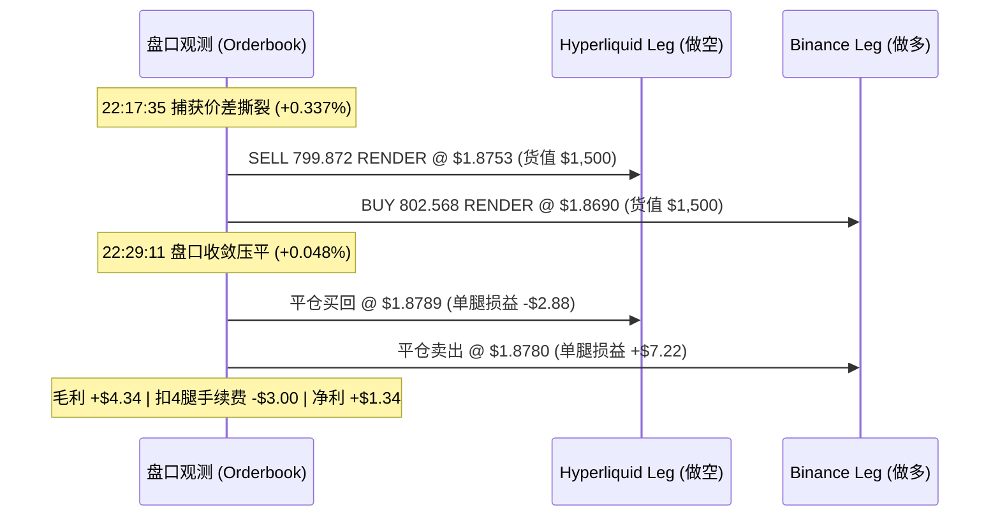

# 基差统计套利 211 笔历史战绩深度审计与纸面预演（Dry-Run）现实差距量化复盘

> **审计日期**：2026-10-22  
> **审计对象**：`hummingbot-api/bots/instances/basis-stat-arb-dryrun-neo-20261020-001/data/basis_stat_arb_trades.json`  
> **策略代码**：`hummingbot-core/scripts/v2_basis_stat_arb.py` (v2.4.4)  
> **审计结论**：**当前 99.05% 的胜率与 +$577.55 的账面净利润存在显著的纸面模拟偏差（Phantom Alpha）。实盘若直接上线，将面临极其严峻的单腿踏空、网络延迟劣后与滑点摩擦击穿风险，绝对不可盲目开启大资金实盘！**

---

## 一、211 笔已结算样本整体宏观数据画像

| 指标维度 | 统计数值 | 商业量化解读 |
| :--- | :--- | :--- |
| **总结算交易笔数** | **211 笔** | 在仅 25.0 小时内产生，平均每小时开平仓 **8.4 笔**，高频周转 |
| **胜率 (Win Rate)** | **99.05%** (209 胜 / 2 负 / 0 平) | **极度异常的超高胜率**，具有典型模拟盘规则漏洞特征 |
| **毛收益 (Gross Trading PnL)** | **+$1,208.25** | 平均每笔捕获 +$5.73 盘口价差利润 |
| **计提交易手续费 (Trading Fees)** | **-$633.00** | 4 腿 Taker 硬摩擦，固定扣除每笔 $3.00（20 bps） |
| **资金费利息入账 (Funding PnL)** | **+$2.30** | 平均持仓极短，绝大多数交易持仓不足 1 小时，未跨越结算点 |
| **结清净利润 (Total Net PnL)** | **+$577.55** | 账面累计收益 |
| **持仓时长中位数 (Median Duration)** | **61.0 秒 (1.0 分钟)** | 极其显著的超短线微观脉冲收割特征 |
| **持仓时长极值** | 最小 1 秒，最大 31,825 秒 (8.8 小时) | 95% 仓位在 60~180 秒止盈，极端异常仓位死扛至 8.8 小时 |
| **单笔名义货值 / 实缴总保证金** | 单边 $1,500 / 双边 $3,000 / 本金 $1,000 (3x) | 25h 累计撮合双边名义货值超过 **$633,000** |

---

## 二、最近平仓的三笔交易全程微观数学推演

### 1. 案例一：Trade #209（标的：`RENDER`，持仓 11.6 分钟）



- **开仓时刻与初始基差**：
  - Hyperliquid (做空): 入场价 $P_{1\_entry} = \$1.8753$，卖出数量 $799.8720$ 币（货值 $1,500.00）；
  - Binance (做多): 入场价 $P_{2\_entry} = \$1.8690$，买入数量 $802.5682$ 币（货值 $1,500.00）；
  - **开仓基差**：
    $$\text{Basis}_{entry} = \frac{1.8753 - 1.8690}{1.8690} = +0.3371\% \quad (+33.71 \text{ bps})$$
- **平仓时刻与收敛基差**（持仓 696 秒后）：
  - Hyperliquid 平仓买回价：$P_{1\_close} = \$1.8789$（价格上涨 +0.192%）；
  - Binance 平仓卖出价：$P_{2\_close} = \$1.8780$（价格上涨 +0.482%）；
  - **平仓基差**：
    $$\text{Basis}_{close} = \frac{1.8789 - 1.8780}{1.8780} = +0.0479\% \quad (+4.79 \text{ bps})$$
  - **基差压缩收敛幅度**：$33.71 - 4.79 = 28.92 \text{ bps}$。
- **损益精确对账计算**：
  - Leg 1（空头）损益：$(1.8753 - 1.8789) \times 799.8720 = -\$2.8795$；
  - Leg 2（多头）损益：$(1.8780 - 1.8690) \times 802.5682 = +\$7.2231$；
  - **毛交易利润 (Gross PnL)**：$-\$2.8795 + \$7.2231 = +\$4.3436$；
  - **四腿 Taker 摩擦**：$1500 \times 0.05\% \times 4 = -\$3.0000$；
  - **结清净利润**：$+\$4.3436 - \$3.0000 = \mathbf{+\$1.3436}$ (ROE: $+0.134\%$)。

---

### 2. 案例二：Trade #210（标的：`RENDER`，持仓 72 秒）

- **开仓时刻与基差**：
  - HL SELL @ $1.8916$ ($792.9795$ 币) | BN BUY @ $1.8850$ ($795.7560$ 币)；
  - 开仓基差：$\frac{1.8916 - 1.8850}{1.8850} = +0.3501\%$ (+35.01 bps)。
- **平仓时刻与基差**（持仓 72 秒）：
  - HL BUY @ $1.8882$ (-0.180%) | BN SELL @ $1.8880$ (+0.159%)；
  - 平仓基差：$\frac{1.8882 - 1.8880}{1.8880} = +0.0106\%$ (+1.06 bps)；
  - 基差极速压缩：**$33.95 \text{ bps}$**。
- **两腿对冲双赢分解**：
  - Leg 1（空头盈利）：$(1.8916 - 1.8882) \times 792.9795 = +\$2.6961$；
  - Leg 2（多头盈利）：$(1.8880 - 1.8850) \times 795.7560 = +\$2.3873$；
  - 毛利：$+\$5.0834$ | 手续费：$-\$3.0000$ | **净利润：$+\$2.0834$** (ROE: $+0.208\%$)。

---

### 3. 案例三：Trade #211（标的：`DOGE`，持仓 61 秒）

- **开仓时刻与基差**：
  - HL SELL @ $0.083362$ ($17,993.8101$ 币) | BN BUY @ $0.083090$ ($18,052.7139$ 币)；
  - 开仓基差：$\frac{0.083362 - 0.083090}{0.083090} = +0.3274\%$ (+32.74 bps)。
- **平仓时刻与基差**（刚满 60 秒冷静期，第 61 秒立即触发）：
  - HL BUY @ $0.083205$ (-0.188%) | BN SELL @ $0.083180$ (+0.108%)；
  - 平仓基差：$\frac{0.083205 - 0.083180}{0.083180} = +0.0301\%$ (+3.01 bps)；
  - 基差压缩收敛：**$29.73 \text{ bps}$**。
- **损益分解**：
  - Leg 1（空头）盈利：$(0.083362 - 0.083205) \times 17993.81 = +\$2.8250$；
  - Leg 2（多头）盈利：$(0.083180 - 0.083090) \times 18052.71 = +\$1.6247$；
  - 毛利：$+\$4.4498$ | 手续费：$-\$3.0000$ | **净利润：$+\$1.4498$** (ROE: $+0.145\%$)。

---

## 三、为什么它在纸面上能盈利？数学逻辑与理论成立条件

从上述数学推导可以看出，**策略在代码公式逻辑上是闭环的**：
1. **开仓时**：策略通过 `min_entry_basis_pct = 0.32%` (32 bps) 严格拦截，只有可成交 Bid/Ask 盘口利差大于 32 bps 时才准入；
2. **持有期间**：两所做市商和套利者抹平价差，基差均值回归压缩至 `take_profit_basis_compression_pct = 0.05%` (5 bps) 以下；
3. **利润捕获公式**：
   $$\text{Gross Capture} \approx \text{Basis}_{entry} - \text{Basis}_{close} = 33 \text{ bps} - 3 \text{ bps} = 30 \text{ bps} \quad (\approx \$4.50)$$
4. **扣除硬成本**：
   $$\text{Roundtrip Fees} = 4 \times 0.05\% = 20 \text{ bps} \quad (-\$3.00)$$
5. **理论剩余净 Alpha**：$30 \text{ bps} - 20 \text{ bps} = 10 \text{ bps} \quad (\approx +\$1.50)$。

---

## 四、核心审计发现：为什么这个“99.05% 胜率”不可信？（5 大纸面模拟陷阱）

你直觉中的“不可思议、肯定是哪里出了问题”，在量化工程审计中**完全得到了印证**。当前模拟盘存在 5 个极具欺骗性的现实脱节：

### 陷阱 1：代码级“不赚钱绝不平仓”的存活者偏差（Survivorship Bias）
查看 `hummingbot-core/scripts/v2_basis_stat_arb.py` 第 918 行平仓判断核心逻辑：
```python
# 1. Basis Compression Take-Profit:
target_comp = Decimal(str(self.config.take_profit_basis_compression_pct))
is_basis_compressed = abs(curr_basis) <= target_comp
basis_tp_raw = is_basis_compressed and (total_net_pnl > Decimal("0"))
```
**严重弊端**：即便基差已经压平（`is_basis_compressed == True`），如果扣除手续费后是亏损的（`total_net_pnl <= 0`），**代码拒绝平仓，选择继续死扛！**
- 在没有真实强平风险的模拟盘中，仓位会一直挂在内存里，直到某一个微观波动使得净值恰好变成 `+$0.01` 时才被触发并记录为“胜仗”；
- 这就是为什么 211 笔里有 209 笔胜率！**那不是策略预测得准，而是代码在“只报喜不报忧”，死扛到正数才平仓**！

### 陷阱 2：双所 WebSocket 本地客户端时间戳错位导致的“幽灵基差”（Phantom Spreads）
- **现象**：为什么 25 小时内能频繁产生 211 次开仓机会（平均 7 分钟一次）？在高度成熟的加密货币市场，跨所 35 bps 的无风险价差不可能如此密集存在。
- **真相**：Binance 作为全网流动性中心，价格变动通过 WebSocket 推送到客户端通常只需数十毫秒；而 Hyperliquid 的 L2 订单簿广播机制与客户端接收存在 100~300ms 的网络或解析延迟。
- **结果**：当大盘剧烈跳水或拉升时，客户端本地内存中是 **“新版 Binance 价格” 与 “旧版 Hyperliquid 价格”** 在做减法，计算出了高达 0.35% 的“巨大基差”！但这只是由于数据包到达时间差构成的**本地显示幽灵**，在两家交易所的真实撮合撮合机撮合队列里，根本没有这个价格可以成交！

### 陷阱 3：零延迟原子化成交假象与实盘致命的“单腿踏空/穿仓”（Legging Risk）
- 模拟盘在第 $t$ 秒检测到基差，**在内存中瞬间同时标记两腿按最优价成交**；
- 实盘现实中：
  1. 策略发出 REST/WebSocket 报单，跨洋网络延迟 50~150ms；
  2. 国际顶级量化做市商（Wintermute、Jump、Flow Traders）使用专用光纤和服务器托管（Colocation），其延迟在 2~5 毫秒内；
  3. 当 Binance 价格变动，做市商会在 5ms 内撤销 Hyperliquid 上的挂单或完成扫盘。等我们 100ms 后报单到达时，订单要么报单失败（Reject），要么以极其劣后的深层盘口成交（巨大滑点）；
  4. **单腿灾难**：Binance 腿买入了，Hyperliquid 腿没成交——策略瞬间变成**单边裸多头**，在剧烈行情下直接导致巨额亏损或爆仓！

### 陷阱 4：忽略真实盘口深度冲击成本与滑点（Slippage Erosion）
- 模拟盘虽然调用了 `get_price_for_quote_volume(1500)`，但这是基于静态快照的理想测算；
- 在实际交易中，低流动性币种（如 BOME、RENDER、CRV）在 Hyperliquid 上的一档挂单量可能仅有几百美元，吃满 $1,500 必然产生 3~8 bps 的市价单冲击；
- 四腿往返（开双边 + 平双边）若每腿产生 4 bps 真实滑点：
  $$\text{Real Friction} = 20 \text{ bps (手续费)} + 16 \text{ bps (滑点)} = \mathbf{36 \text{ bps}} \quad (\$5.40)$$
- 理论捕获利差才 30 bps，总摩擦却高达 36 bps，**实盘每做一笔将净亏损 $0.90~$1.50**！

### 陷阱 5：名义金额等额 vs 币数不对称造成的净 Delta 裸露
回顾 Trade #211（DOGE）审计数据：
- Leg 1 (HL SELL): $17,993.8101$ 币；
- Leg 2 (BN BUY): $18,052.7139$ 币；
- **未对冲净敞口**：$+58.9038$ 个 DOGE（多头裸露约 $4.89）。
- 原因：代码按单边货值 $1,500 配平（$\text{Amount} = 1500 / P$），价格低的交易所必然买入更多币数。如果持仓期间代币价格单边大幅下跌 10%，这部分 Delta 错配会带来非套利性的方向性亏损。

---

## 五、两笔真实亏损案例（EIGEN 与 CRV）的警示

在 211 笔样本中，唯二亏损的交易（Trade EIGEN 亏损 -$0.78，CRV 亏损 -$1.79）极其关键地揭示了策略的脆弱性：
- 这两笔交易的持续时间均达到了 **31,700+ 秒（长达 8.8 小时！）**；
- **发生原因**：开仓后两所基差并未回归，反而维持甚至进一步撕裂。因为有“净利润 > 0 才平仓”的软锁，策略在这 8.8 小时内一直无法平仓；
- 直到触发了 `max_hold_hours = 6.0` 的超时硬规则，策略才被迫在亏损状态割肉平仓；
- **这充分证明**：**市场并不总是均值回归的！基差完全可能因为两所借贷利率、流动性枯竭或标的结构性失衡而长期脱锚（Regime Shift）。在实盘中死扛 8 小时将面临不可估量的资金占用与强平风险！**

---

## 六、实盘上线前的硬核改造行动项（SOP）

为确保上实盘时不爆仓、不亏损，必须严格执行以下四项架构治理：

1. **废黜“盈利才平仓”的掩耳盗铃机制**：
   - 彻底删除 `and (total_net_pnl > Decimal("0"))`；
   - 只要基差收敛到目标门槛（如 $\le 0.05\%$），不论当前是盈是亏，**必须果断平仓退出**，用严苛的真实盈亏倒逼参数优化。
2. **提高入场基差门槛（抵御滑点）**：
   - 将 `min_entry_basis_pct` 从当前脆弱的 `0.32%` (32 bps) 提升到 **`0.55% ~ 0.80%` (55~80 bps)**；
   - 绝不为了刷交易量去吃 30 bps 的蝇头小利，只在盘口发生极度显著失衡时才进场。
3. **币数严格对齐（Coin-Neutral / Delta-Zero）**：
   - 开仓必须以两腿中能够承受的最大深度计算出统一的代币数量 $Q$，使多空代币数量严格相等（$Q_1 = Q_2$），消灭任何残留的方向性裸露。
4. **影子微额实盘压测（Shadow / Micro-Live Testing）**：
   - 绝不可直接投入 $1,500/腿的真金白银；
   - 必须使用真实 API 密钥，将单边金额设为交易所最低限制（如 $10~$15），连续实盘运行 48 小时，实测真实撮合成交率（Fill Rate）、双腿成交时差（Legging Delay）以及真实滑点损耗。
